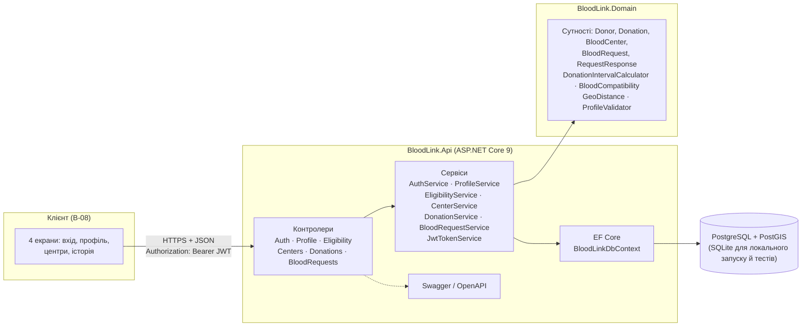

# Обґрунтування архітектури та інструментів (B-12)

**Коротко:** BloodLink у модулі 2 — це клієнт-серверна система з REST API на ASP.NET Core, базою PostgreSQL і тонким клієнтом. Бізнес-правила (калькулятор, відстань, валідація профілю) винесені в окремий проєкт `BloodLink.Domain` без залежностей від веба й БД, тому їх легко покрити модульними тестами.

## Компоненти

Шари й залежності йдуть в один бік: контролери → сервіси → домен / EF Core. Контролери лише приймають HTTP-запит, дістають id донора з JWT і викликають сервіс. Помилки бізнес-логіки (`ServiceException`) один обробник перетворює на відповідь `application/problem+json` (RFC 7807).

## Структура репозиторію

| Шлях | Що там |
| --- | --- |
| `src/BloodLink.Domain` | Сутності, переліки, калькулятор наступної здачі, відстань, валідація профілю. Без залежностей. |
| `src/BloodLink.Api` | Web API: контролери, сервіси, EF Core, JWT, Swagger; `wwwroot` — мінімальний клієнт. |
| `tests/BloodLink.UnitTests` | Модульні тести (xUnit): домен і сервіси, SQLite у пам'яті. |
| `tests/BloodLink.IntegrationTests` | Інтеграційні тести: HTTP-запити до застосунку в пам'яті (`WebApplicationFactory`). |
| `docs/` | UML, схема БД, архітектура, API, журнали тестування, план і рефлексія спринту. |
| `.github/` | CI (збірка й тести на кожен PR) і шаблон Pull Request. |

## Чому саме ці інструменти

| Рішення | Чому | Альтернативи й чому ні |
| --- | --- | --- |
| **ASP.NET Core 9 Web API (C#)** | Команда знає C# з попередніх курсів; вбудовані DI, валідація, JWT, OpenAPI; висока продуктивність; LTS-платформа. | FastAPI (Python) — згаданий у пітчі; лишаємо Python для ML-сервісу прогнозу навесні, а основний API — на C#, щоб мати строгу типізацію й EF Core. |
| **Entity Framework Core** | ORM з LINQ, міграціями й провайдерами для PostgreSQL і SQLite: той самий код працює в продакшні й у тестах. | Dapper — швидший, але більше ручного SQL; для CRUD модуля 2 ORM дає швидший результат. |
| **PostgreSQL + PostGIS** | Безкоштовна, надійна; PostGIS дасть пошук донорів у радіусі 15 км для SOS (B-14) прямо в SQL. | MS SQL — платні тарифи хостингу; MongoDB — дані реляційні (донор → донації → центр). |
| **SQLite** (локально й у тестах) | Запуск без Docker одним `dotnet run`; тести на справжній реляційній БД у пам'яті, а не на InMemory-провайдері. | EF InMemory — не перевіряє обмеження й унікальні індекси. |
| **JWT (Bearer)** | Stateless-автентифікація, природна для мобільного клієнта; пароль зберігається як хеш PBKDF2 (`PasswordHasher`). | Cookie-сесії — незручні для мобільного застосунку. |
| **Swagger (Swashbuckle)** | Документація генерується з коду й XML-коментарів, тож не розходиться з реалізацією; можна викликати API з браузера. | Ручна документація — швидко застаріває. |
| **xUnit + WebApplicationFactory** | Стандарт для .NET; інтеграційні тести проходять увесь конвеєр (маршрути, JWT, валідація, БД) без окремого сервера. | Postman-колекції — не запускаються в CI так просто. |
| **GitHub + Actions** | Захищена гілка `main`, PR з рев'ю, CI запускає всі тести на кожен PR. | GitLab — команда вже працює з GitHub. |
| **Мінімальний веб-клієнт** (HTML/JS у `wwwroot`) | За тиждень модуля 2 дає робоче демо всього сценарію без збірки мобільного застосунку. | React Native (план на весну) — потрібен час на налаштування середовища; API вже готовий для нього. |

## Безпека й приватність

- Паролі — лише у вигляді хешу (PBKDF2, `Microsoft.AspNetCore.Identity.PasswordHasher`).
- Ключ підпису JWT не зберігається в репозиторії для продакшну: `Jwt:Key` задається змінною середовища `Jwt__Key`.
- Донор бачить і змінює тільки власні дані: id береться з токена, а не з запиту; чужий запис дає 404.
- Телефон автора запиту на кров видно лише донорам, які натиснули «Я допоможу»; список донорів, що відгукнулися, бачить лише автор. Про пацієнта зберігаються тільки ініціали.
- Однакова відповідь на «немає такого email» і «невірний пароль», щоб не розкривати зареєстровані адреси.
- Медичні дані (група крові, донації) — чутливі; шифрування в стані спокою й аудит доступу заплановані на весну разом із кабінетом центру.

## Чому клієнт у модулі 2 вебовий, а не мобільний

У дорожній карті клієнтом був мобільний застосунок на React Native, але в модулі 2 клієнт — мінімальна вебсторінка в `wwwroot`. Це рішення саме на модуль 2: за тиждень потрібно було показати робочий наскрізний сценарій (вхід → профіль → центри → історія → запити на кров), а вебклієнт запускається разом з API однією командою й не потребує окремого середовища збірки. Бекенд від клієнта не залежить: REST API з JWT однаковий для будь-якого клієнта. Далі плануємо мобільний клієнт на React Native, який працюватиме з тим самим API без змін на бекенді (див. нижче).

## Що свідомо відкладено на весну

Карта замість списку, push-сповіщення донорам про нові запити поруч (Firebase Cloud Messaging + PostGIS), кабінет центру крові, міграції EF Core замість `EnsureCreated`, мобільний клієнт на React Native, ML-сервіс прогнозу дефіциту на Python.
