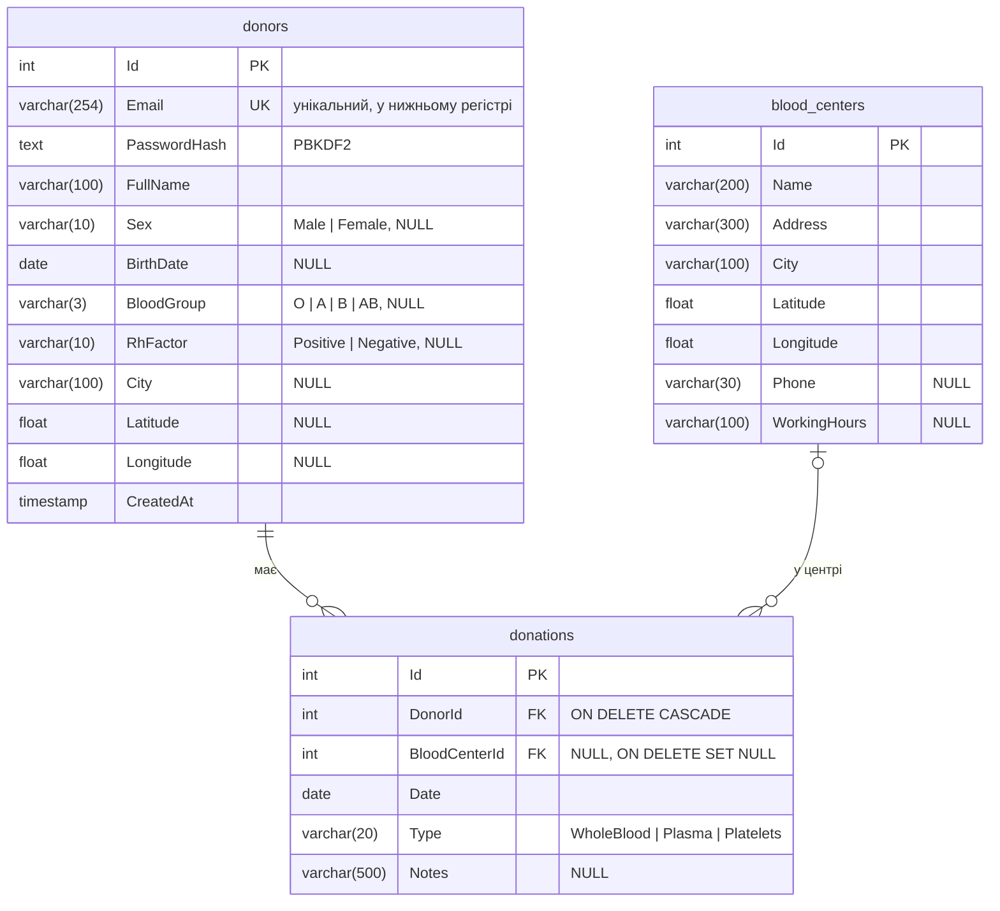

# Схема бази даних (B-01)

**Коротко:** три таблиці — донори, центри крові й донації. Донор має багато донацій; донація може посилатися на центр. Схему описує `BloodLinkDbContext` (EF Core), тож вона однакова для PostgreSQL і SQLite.

## ER-діаграма

## Обмеження й індекси

| Таблиця | Обмеження | Навіщо |
| --- | --- | --- |
| `donors` | `UNIQUE (Email)` | Один обліковий запис на email; email нормалізується до нижнього регістру. |
| `donations` | `FK DonorId → donors.Id ON DELETE CASCADE` | Видалення донора видаляє і його історію. |
| `donations` | `FK BloodCenterId → blood_centers.Id ON DELETE SET NULL` | Закриття центру не знищує історію донора. |
| `donations` | `INDEX (DonorId, Date)` | Швидка вибірка історії донора і останньої донації для калькулятора. |

Переліки зберігаються як рядки (`HasConversion<string>()`): у БД видно `"WholeBlood"`, а не `1`, і додавання нового значення не зсуває старі.

## Початкові дані

П'ять демо-центрів крові в Києві (`SeedData.Centers`) — назви й координати умовні й позначені «(демо)». Наповнення бази реальними центрами — окрема задача беклогу.

## Плани на весну

- PostGIS-колонка `geography(Point)` замість пари `Latitude/Longitude` і просторовий індекс — для SOS у радіусі 15 км.
- Таблиці `sos_requests` і `notifications`, обліковий запис центру крові.
- Міграції EF Core (`dotnet ef migrations add`) замість `EnsureCreated`.
