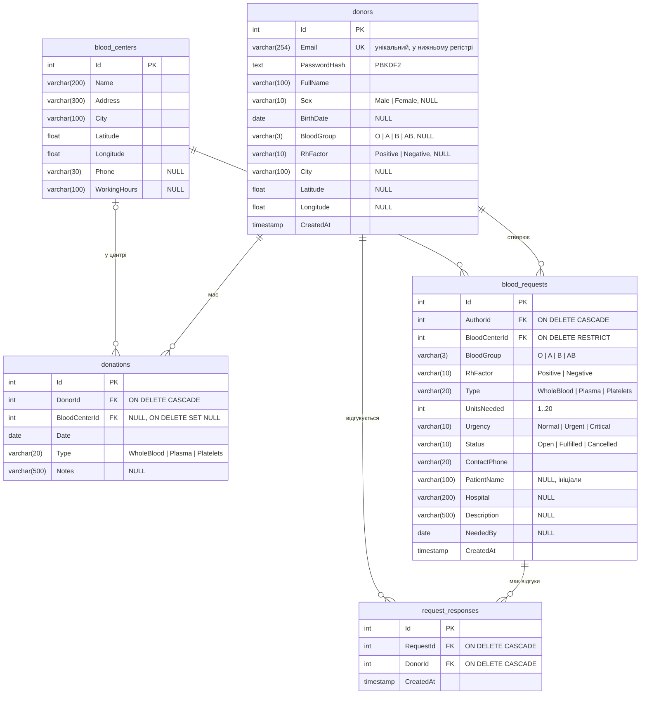

# Схема бази даних (B-01)

**Коротко:** п'ять таблиць — користувачі (донори), центри крові, донації, запити на кров і відгуки донорів на запити. Один обліковий запис може і здавати кров, і шукати її для близької людини. Схему описує `BloodLinkDbContext` (EF Core), тож вона однакова для PostgreSQL і SQLite.

## ER-діаграма

## Обмеження й індекси

| Таблиця | Обмеження | Навіщо |
| --- | --- | --- |
| `donors` | `UNIQUE (Email)` | Один обліковий запис на email; email нормалізується до нижнього регістру. |
| `donations` | `FK DonorId → donors.Id ON DELETE CASCADE` | Видалення донора видаляє і його історію. |
| `donations` | `FK BloodCenterId → blood_centers.Id ON DELETE SET NULL` | Закриття центру не знищує історію донора. |
| `donations` | `INDEX (DonorId, Date)` | Швидка вибірка історії донора і останньої донації для калькулятора. |
| `blood_requests` | `FK BloodCenterId → blood_centers.Id ON DELETE RESTRICT` | Не можна видалити центр, поки на нього посилаються запити. |
| `blood_requests` | `INDEX (Status, BloodGroup, RhFactor)` | Швидкий пошук відкритих запитів потрібної групи. |
| `request_responses` | `UNIQUE (RequestId, DonorId)` | Донор відгукується на запит лише один раз. |

Переліки зберігаються як рядки (`HasConversion<string>()`): у БД видно `"WholeBlood"`, а не `1`, і додавання нового значення не зсуває старі.

## Початкові дані

П'ять демо-центрів крові в Києві (`SeedData.Centers`) — назви й координати умовні й позначені «(демо)». Наповнення бази реальними центрами — окрема задача беклогу.

## Плани на весну

- PostGIS-колонка `geography(Point)` замість пари `Latitude/Longitude` і просторовий індекс — для SOS у радіусі 15 км.
- Таблиця `notifications` для push-сповіщень про нові запити, обліковий запис центру крові.
- Міграції EF Core (`dotnet ef migrations add`) замість `EnsureCreated`.
