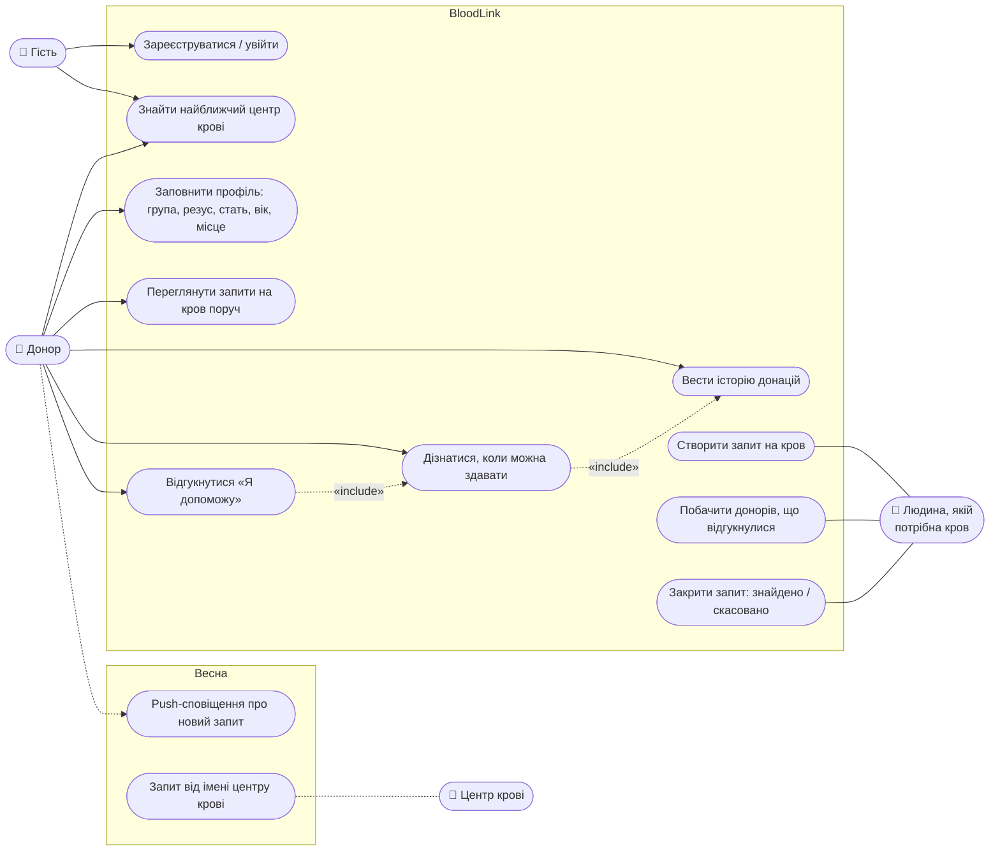
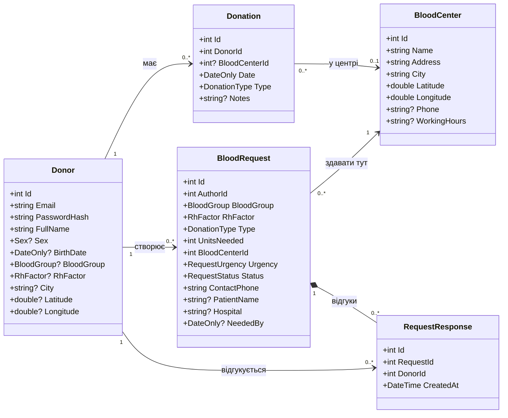
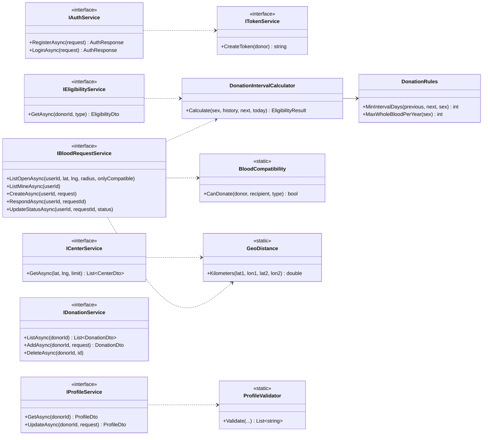
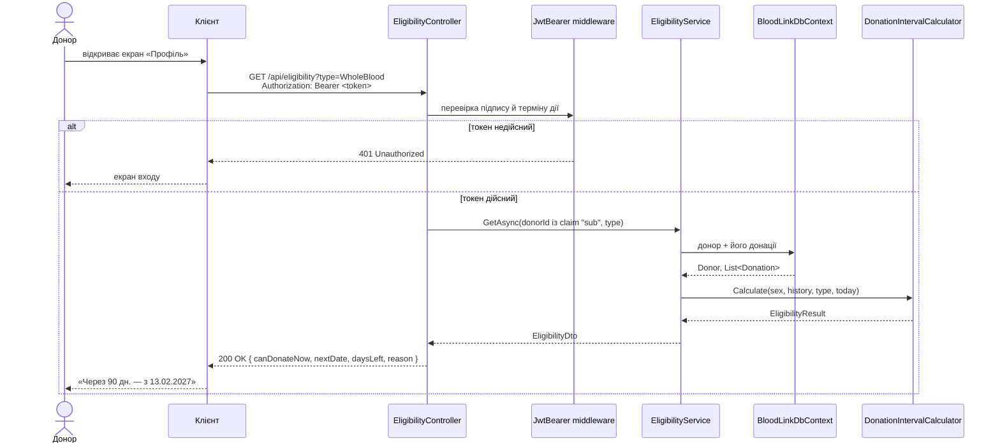
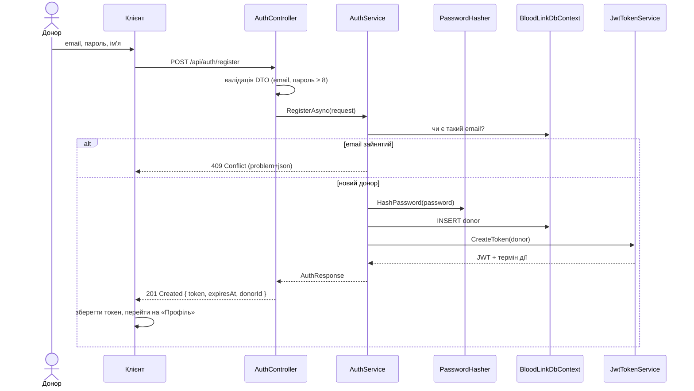
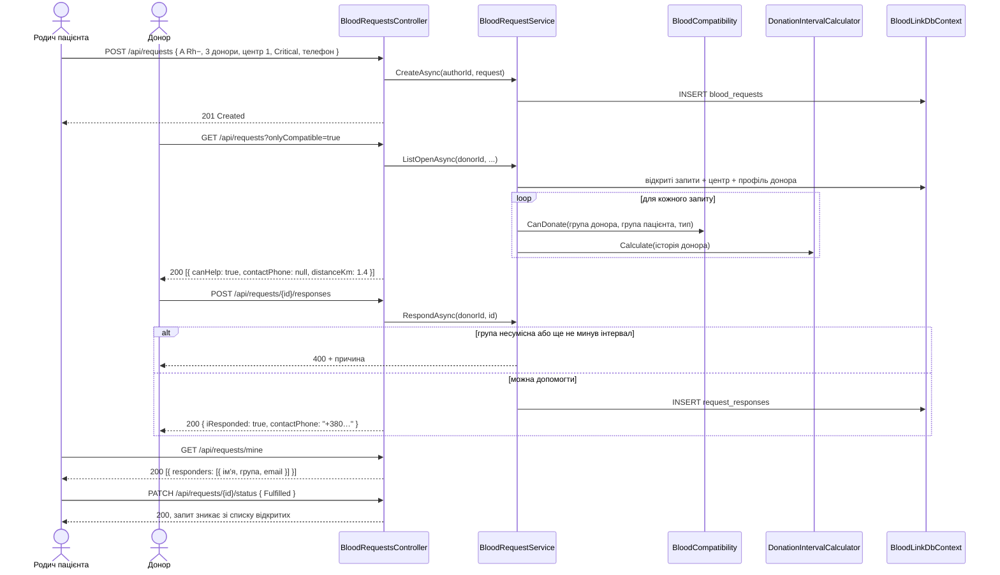

# UML-моделі системи (B-12)

Діаграми написані в Mermaid: GitHub показує їх прямо в цьому файлі, а змінюються вони разом із кодом у PR.

## 1. Діаграма варіантів використання

Гість може зареєструватися, увійти й переглянути центри (`/api/centers` — публічний ендпоінт); решта дій потребує входу. Донор і людина, якій потрібна кров, — ролі одного облікового запису: родич пацієнта може сам бути донором. Калькулятор (UC4) рахує дату за історією донацій (UC6). Відгукнутися (UC14) можна лише за сумісної групи й після мінімального інтервалу, тому UC14 включає UC4. Пунктиром — функції, заплановані на весну.

## 2. Діаграма класів: модель даних

Переліки: `BloodGroup {O, A, B, AB}`, `RhFactor {Positive, Negative}`, `Sex {Male, Female}`, `DonationType {WholeBlood, Plasma, Platelets}`, `RequestUrgency {Normal, Urgent, Critical}`, `RequestStatus {Open, Fulfilled, Cancelled}`.

## 3. Діаграма класів: сервіси та бізнес-логіка

Кожен інтерфейс має одну реалізацію з такою ж назвою без `I` (`AuthService`, `BloodRequestService` тощо); контролери залежать лише від інтерфейсів. Усі сервіси читають і записують дані через `BloodLinkDbContext` (EF Core) — ці зв'язки на діаграмі не показані, щоб не перевантажувати її. Бізнес-правила (`DonationIntervalCalculator`, `BloodCompatibility`, `GeoDistance`, `ProfileValidator`) лежать у проєкті `BloodLink.Domain` і не залежать від веба чи БД.

## 4. Діаграма послідовності: «коли мені можна здавати?»

## 5. Діаграма послідовності: реєстрація і вхід

## 6. Діаграма послідовності: запит на кров і відгук донора

