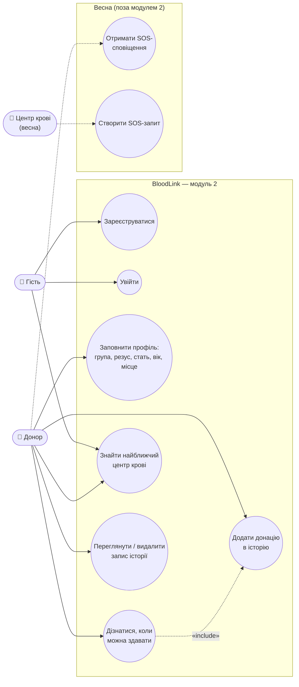
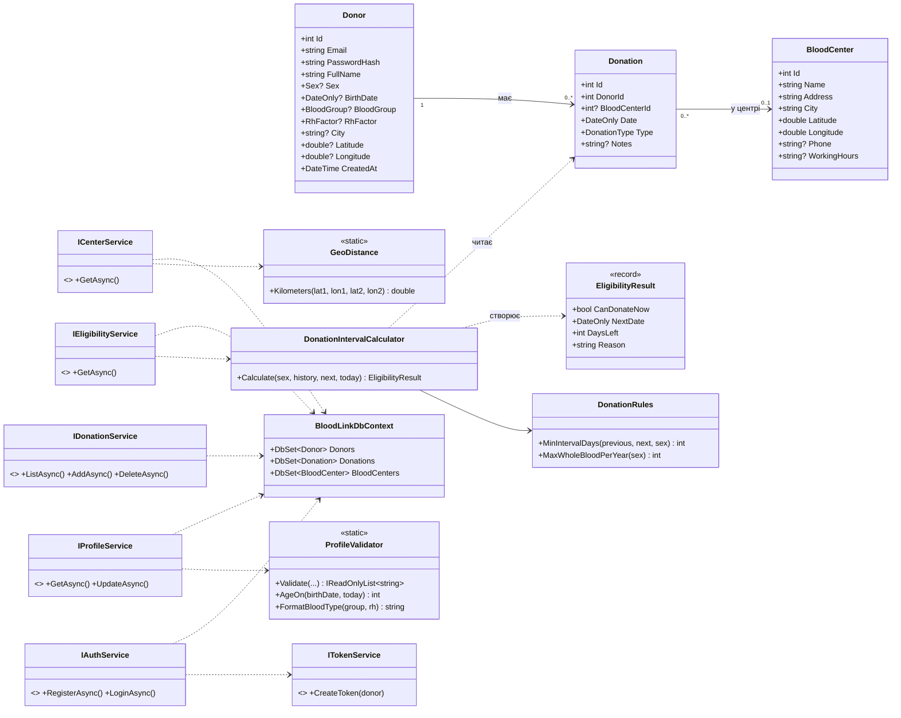
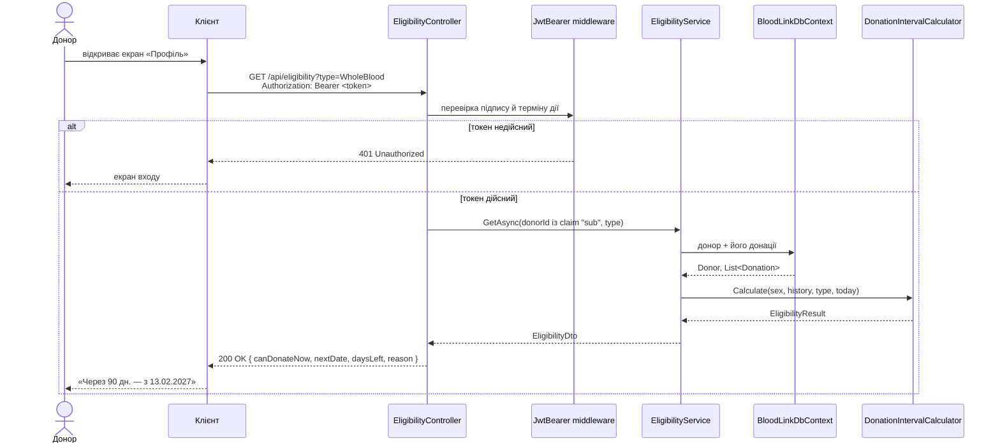
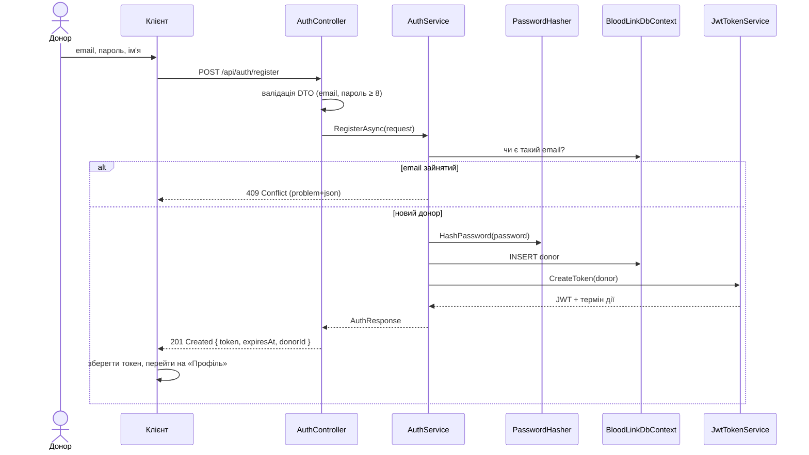

# UML-моделі системи (B-12)

Діаграми написані в Mermaid: GitHub показує їх прямо в цьому файлі, а змінюються вони разом із кодом у PR.

## 1. Діаграма варіантів використання

Гість може зареєструватися, увійти й переглянути центри (ендпоінт `/api/centers` публічний). Решта дій потребує входу. Калькулятор (UC4) рахує дату за історією донацій (UC6).

## 2. Діаграма класів

Переліки: `BloodGroup {O, A, B, AB}`, `RhFactor {Positive, Negative}`, `Sex {Male, Female}`, `DonationType {WholeBlood, Plasma, Platelets}`. Кожен інтерфейс сервісу має одну реалізацію з такою ж назвою без `I` (`AuthService`, `ProfileService` тощо); контролери залежать лише від інтерфейсів.

## 3. Діаграма послідовності: «коли мені можна здавати?»

## 4. Діаграма послідовності: реєстрація і вхід

